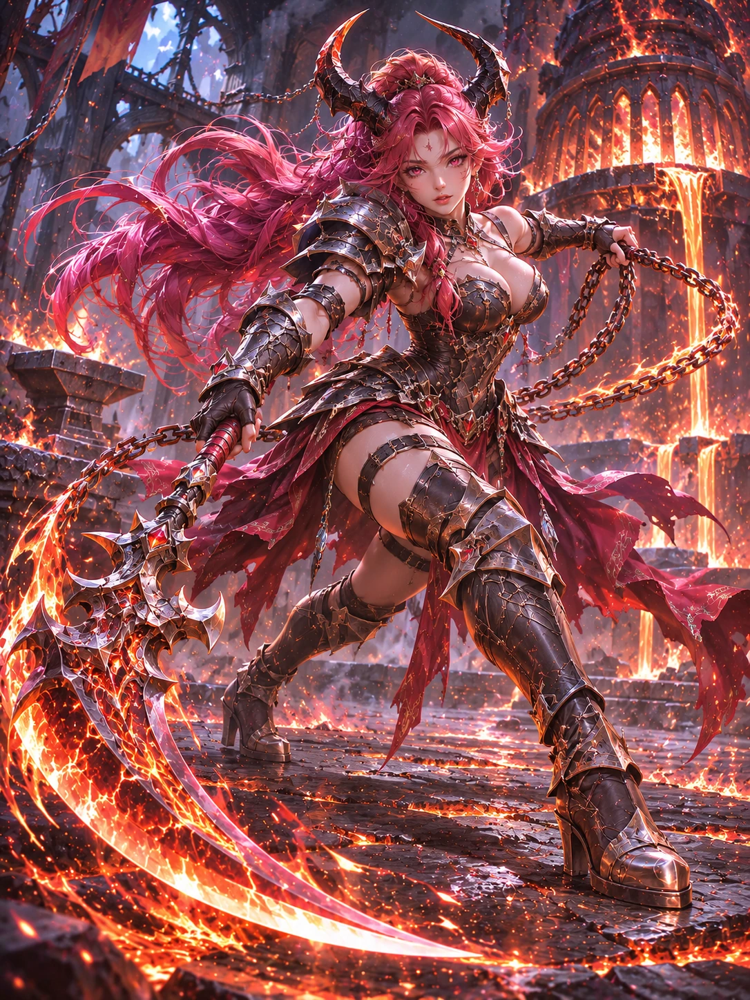

# 炽角·余烬 独立战斗动作研究 G1-03 · 2026-11-21

> **仅研究稿，尚未通过人工美术与权利审核，不能改动正式 CG 卡位。** 本轮专门解决此前多次生成五人拼版、无法作为独立角色原画的问题。

| 字段 | 记录 |
| --- | --- |
| 卡位 | `cinder-ember` |
| 资源路径 | `public/art/beauty-beasts/characters/cinder/cg-ember-pose-study-v1.webp` |
| 原生 PNG / WebP | 1086×1448 / 1086×1448 |
| WebP 大小 | 591622 bytes |
| SHA-256 | `37b1865233799c582aea5917655bc27b9f2deaa928b633becceeeb41814fb808` |
| Git Blob SHA-1 | `b12408260d7db5b16e89977dae24395df198d9ae` |
| 来源 | OpenAI 图像生成，2026-11-21；PNG 原图独立生成后导出为 WebP quality 91 |
| 审核/生产结论 | `research-only`，`approved: false`；不得使用 `art:cg:promote` |

## 单人画面和差异化阶段性结果

- 独立竖幅仅有一位成年红粉发、成对深色弯曲魔角的炽角；**不是五人拼版裁切**，不含烘焙角色姓名、标题、按钮或品阶。
- **动作**：双足一前一后形成大幅弓步，腰腹前倾，前手控制长镰链柄，后手带出锁链弧线；与月纱的支配者台阶站姿、泉泡踏浪旋身的 S 型姿态不同。
- **服装**：黑铁赤铜分节护肩、护臂、护腿、战靴和分叉战裙；材质偏重型锻炉战甲，不再重复泉泡水纱和月纱宫廷装。
- **武器**：锁链镰与橙红火焰飞弧，处于发动攻击的动作中；武器占据独立画面轮廓。下一稿仍需完善武器起终点的受力和刀刃边界。
- **身份**：粉红到暗红发丝、黑色弯角与原 `cinder/face.webp` 大体一致；但眼距、颧骨、鼻唇、发际线与角根固定仍需正面对比审查，**不能自动判定已同人**。

## 失败与下一次必须修复的项目

1. 原生图 **1086×1448**，低于 `1536×2048` 正式原画门槛；不允许插值放大伪称原生通过。
2. 大型火焰镰刃弧线向左下延伸接近画框边缘，窄卡 cover 可能截断；需给刀刃、双手、足部更大的安全边距。
3. 需要逐项审视指节、双手受力、双腿关节、锁链连接关系、铁甲结构与背景接触阴影。
4. 未进行 96px 黑剪影可辨认度、人脸骨相并排比对、1440×900 / 1648×928 / 390×844 真浏览器视口检查，也未签署版权/人工验收。
5. 此研究稿永远不能替代 `cg-ember-candidate.webp` 或 `cg-ember.webp`，除非未来重新产出合格新图，经过完整审批和 hash/manifest/CI 流程。

## 下一步

优先修复泉泡的毛绒兽耳与偏银白的浅蓝发，并完成青枝「侧身满弓」和月纱「侧坐誓约」两套**彼此独立**的动作研究。当前 `cg-manifest.json` 的五张卡仍全部 `portrait`，不得把研究稿当正式立绘上线。
