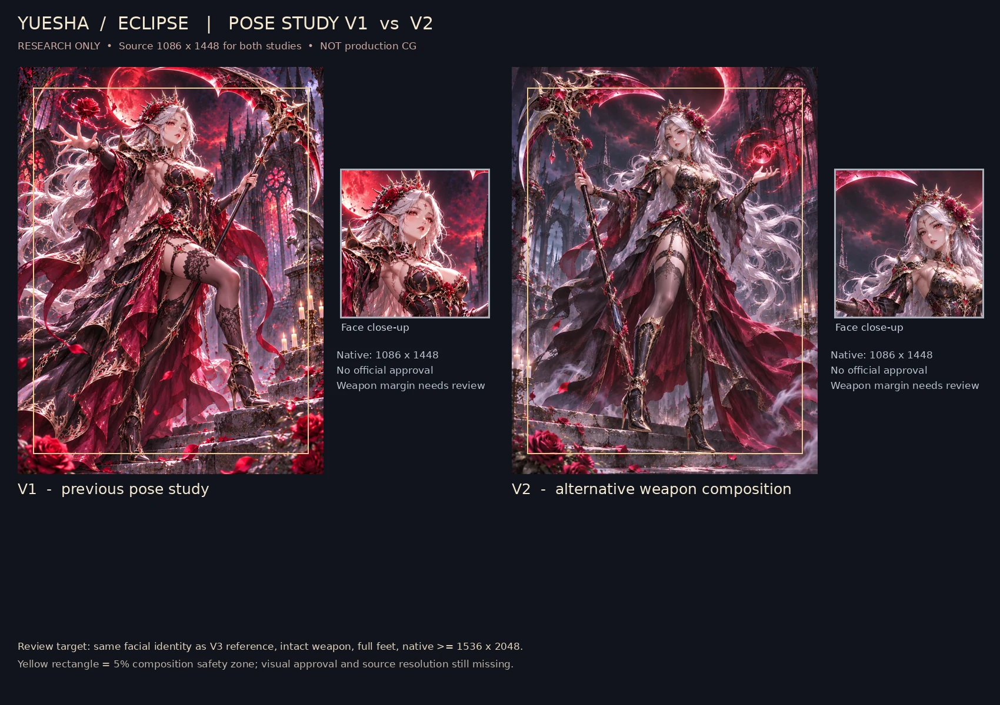

# 月纱·月蚀：原生高清尝试与 V2 备选构图审查（2026-11-22）

> 状态 **research-only / selected:false / approved:false**。本次没有生产合格的 1536×2048 原生 CG，也没有替换现有 `cg-eclipse-candidate.webp` 预览或修改 `cg-manifest.json`。V1 仍是镜头表中当前的主要研究基线。

## 生成和文件证据

| 项目 | 结果 |
| --- | --- |
| 角色 | `yuesha-eclipse`，原生独立单人画面 |
| V2 文件 | `docs/art-reviews/sources/yuesha-cg-eclipse-pose-study-v2.webp` |
| PNG 原生像素 | **1086×1448**（不是正式要求的 1536×2048） |
| WebP 导出像素 | 1086×1448；513912 B（quality 92，未放大） |
| WebP SHA-256 | `6f3f41109ccef8e3d1fcb1e96176ae241c27b609ab60fa47652fb34cd6cc0aa9` |
| Git Blob SHA-1 | `ca6fd2886d1299a5caba77099436efcfcc2617b0` |
| 原始 PNG SHA-256 | `040d79219028c478cc55fb53f6485ef43e96b25de4814cbb15072cbaf40edf8d` |
| QA 对照板 | `docs/art-reviews/yuesha-eclipse-pose-v1-v2-qa-2026-11-22.webp`，1700×1200，353470 B |
| QA SHA-256 | `5cb51a355a63a3471b7cea53142db006453b03d7229fb14020e574d059d9f2be` |
| 生成来源 | OpenAI 图像生成，2026-11-22 |
| 正式审查/商业使用确认 | **未签署** |

## 差异化观察

- V2 保留银白长发、赤瞳、蔷薇冠、黑金战斗服及月蚀长镰的视觉设定，使用手持长镰 + 另一只手操控血月的构图；一个人物，一张独立场景，无烘焙 UI/标题/分栏。
- V1 是高抬腿登阶、弧形镰刃位于画幅右上；V2 是稍更正面的台阶站姿、镰刃放在画幅左上，便于并排比较战斗姿态和武器轮廓。
- **问题**：V2 镰刃接近画面上边及左边；人物的眼距、颧骨、嘴唇应与 `public/art/yuesha-portrait-v3.webp` 和 V1 并列核对，不能只凭银白发和红眼认定同人。V2 的动作张力也需人工决定是否真正优于 V1。
- QA 图中黄色框表示画面 5% 安全边距参考，属于审核辅助；不能把此框内武器或人物情况自动当作通过。

## 实际生产阻碍与下一步

1. 本轮尝试从研究稿过渡到正式高清生成，但**得到的独立角色原始 PNG 仍只有 1086×1448**；另外几次结果为带文字的五人拼版，已直接拒绝，不计为合格独立 CG，也不入库。
2. **绝不软件插值放大后宣称原生高分辨率**。下次正式制作必须通过支持原生至少 1536×2048 的工作流输出独立源图，并保留原始 PNG/分层文件和来源尺寸记录。可使用成熟图像制作工具，但不降低既有门槛。
3. 新原画必须解决镰刃、头饰、两脚和发梢的边缘安全区、脸部身份、手指与武器受力问题，形成完整 3:4 源稿，并检查 96px 剪影可识别度。
4. 必须完成真实 1440×900、1648×928、390×844 三个浏览器视口的 `contain` 与窄卡 `cover` 审核、著作权/来源审核、人工审阅签名，才运行 `art:cg:promote`。
5. **现有运行时状态不变**：五张卡都必须仍为 `portrait`，月纱月蚀仍指向已哈希验证的原候选预览。V2 只作为未选择的设计方向，不能在此时晋级正式资源。

本稿用于记录真实问题，**不是正式美术质量通过证明**。
