# 《怪物公寓》人物身份 × 动作 × 服装 × 武器对照评审板

> **2026-11-21 · 研究阶段，尚未通过人工签署。** 真实图片一律使用仓库内实际文件链接，不用生成的模拟拼版做比对，也不把任何 pose-study 视为生产 CG。详见 [差异化制作规范](../CHARACTER-CG-DIFFERENTIATION-V1.md) 与 [镜头表](CG-DIFFERENTIATION-SHOT-LIST.json)。

## 四张独立原画动作 QA 对照板（非正式资产）

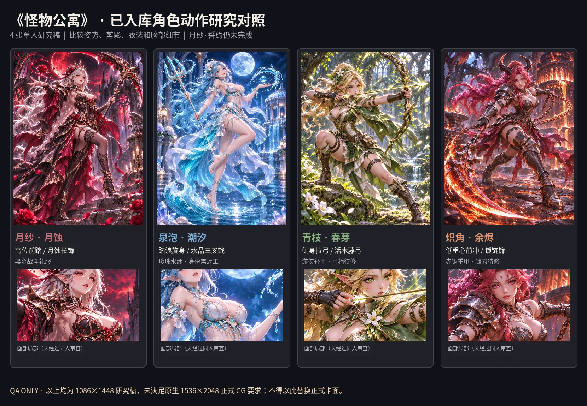

此对照板仅使用已入库的四张**单人物动作研究稿**生成，合成尺寸 **1660×1150**，WebP 大小 **428690 bytes**，SHA-256 `34f37143622a3a96d3f26aff88a45d2f9b4d2952eb1fe23325754d5385a59c7b`。板内四列分别为月纱月蚀、泉泡潮汐、青枝春芽、炽角余烬；下方脸部局部只是方便人眼比较的 QA 裁切，不得当作新的肖像原画或正式立绘。

**制作边界**：这是质检接触表，不是项目的第五张 CG，也不包含尚未独立完成的「月纱·誓约」。四幅原生源图均只有 1086×1448，暂未通过正式分辨率、骨相、装备边缘及浏览器视口审核。

## 研究稿一览

| 卡面 | 不可改变的人物身份参考 | 最新独立动作研究 | 对照结论 |
| --- | --- | --- | --- |
| **月纱·月蚀** | 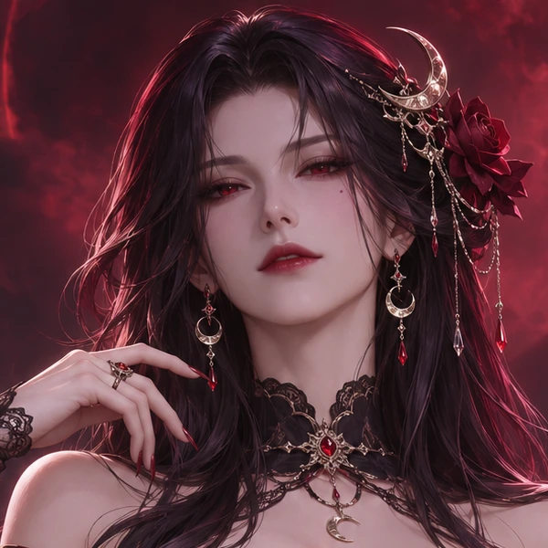 | 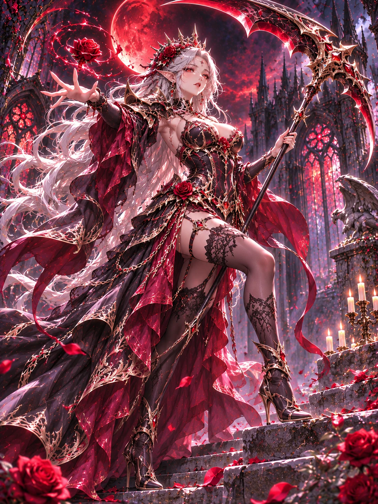 | **待改**：镰刃安全区、银发 V3 面部一致性；尚未达原生尺寸 |
| **泉泡·潮汐** | 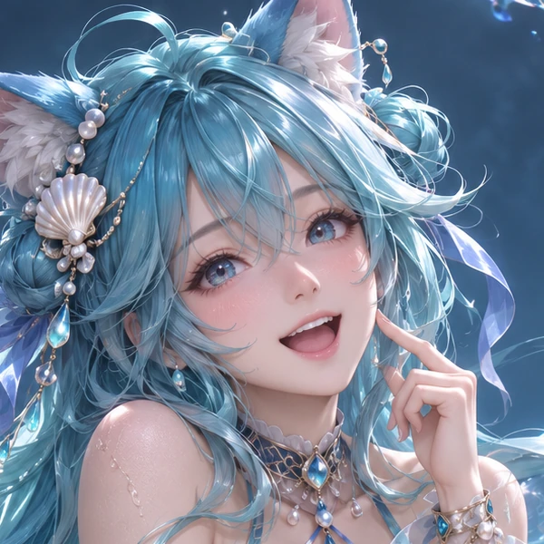 | 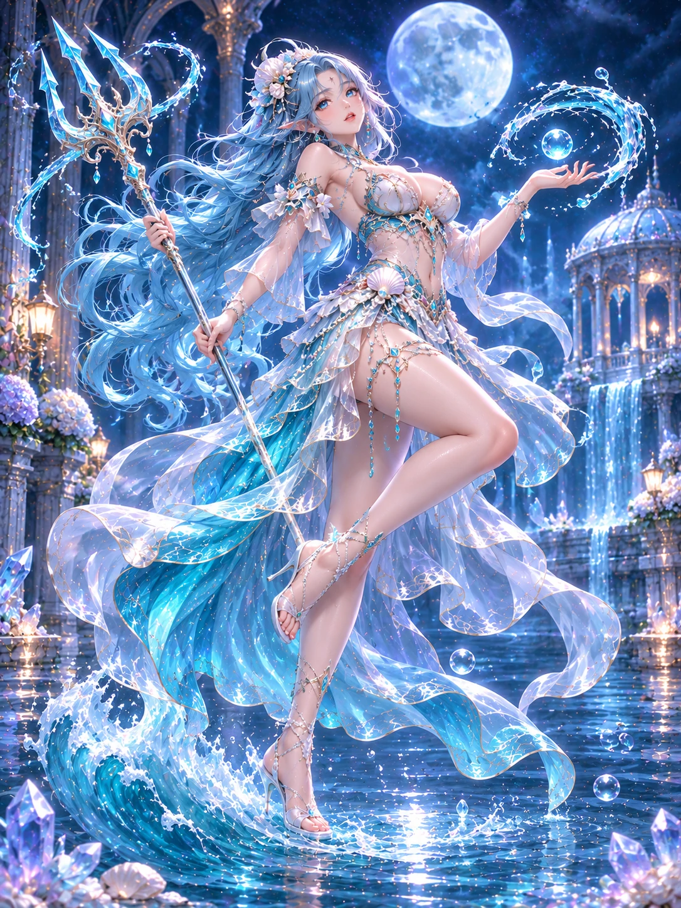 | **身份未通过**：浅银蓝发和毛绒蓝色兽耳变成鲜蓝发、精灵尖耳，不能晋级 |
| **炽角·余烬** | 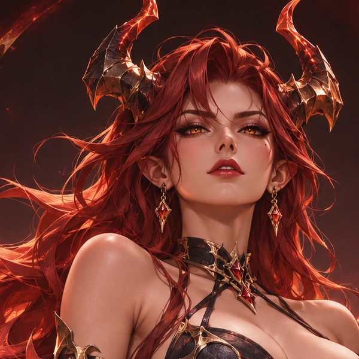 | 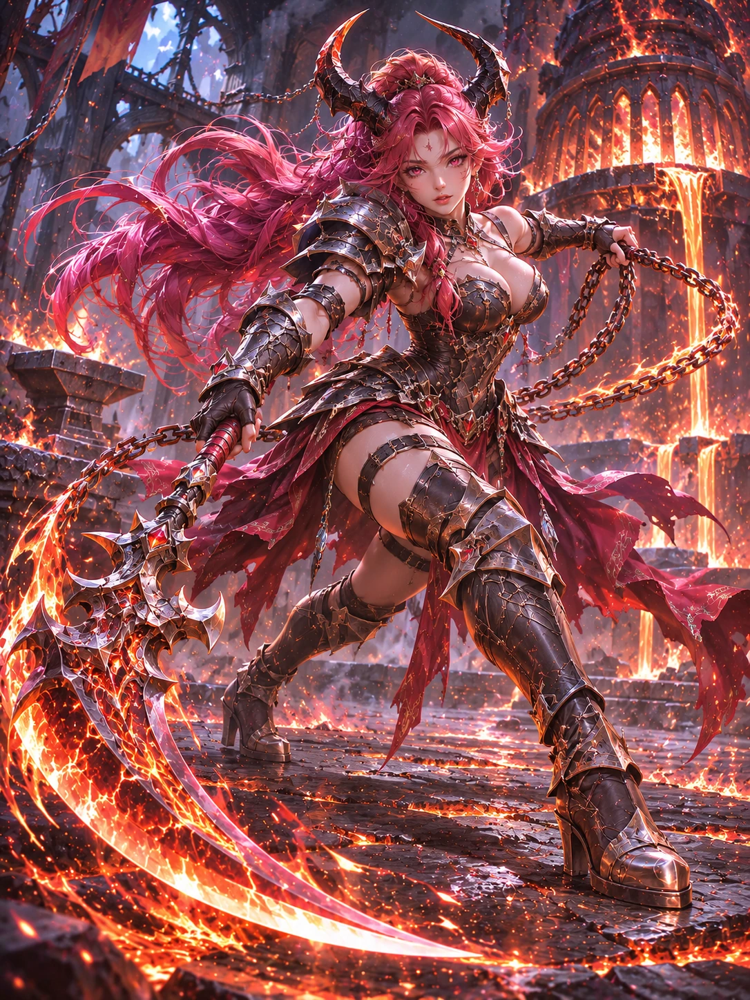 | **单人战斗姿态完成**：粉红红发、双角、甲胄和宽弓步符合重制方向；镰刃边距和骨相仍需复核 |
| **青枝·春芽** | 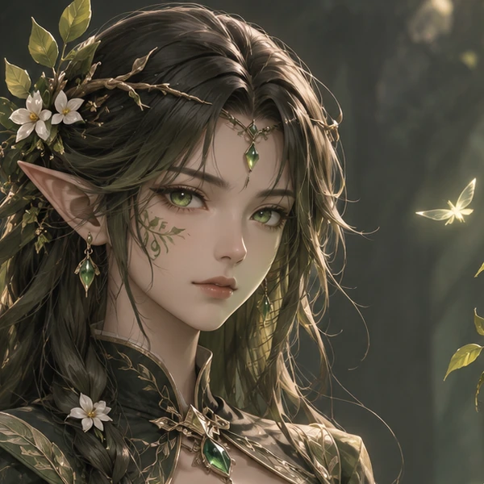 | 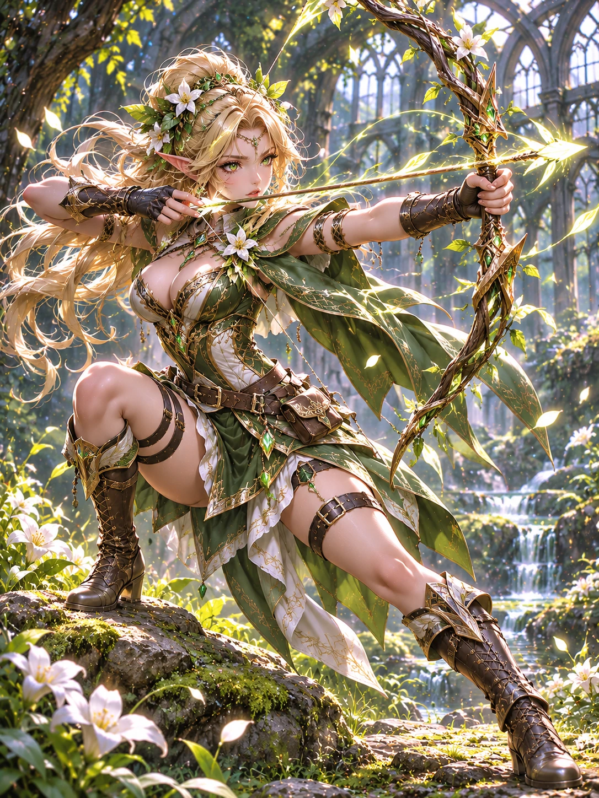 | **单人游侠拉弓研究稿已入库**；藤弓上缘/箭尖接近边界，手指与身份未签署，尺寸不足 |
| **月纱·誓约** | 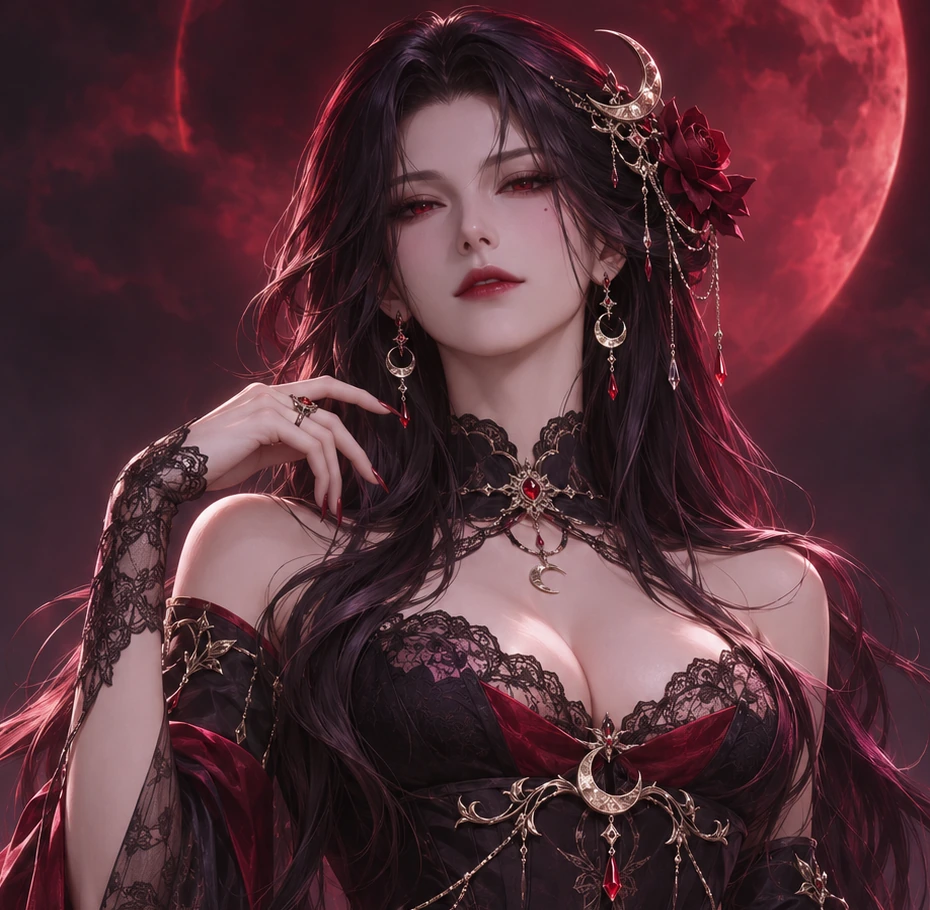 | 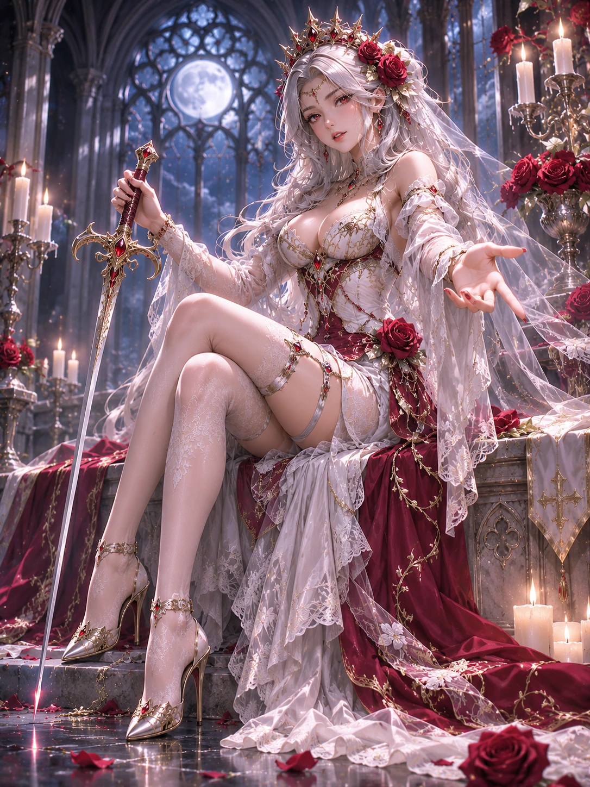 | **G2-02 独立姿势研究稿完成**：侧坐、伸手邀请、誓约细剑、银白酒红仪式裙；两张月纱的面部身份与细剑边距尚待审核，非正式 CG |

> GitHub 的上表显示实际入库图片。**不能根据图片旁边写了“完成”就认为人物身份通过**：目前所有已入库研究稿均为 1086×1448；正式 CG 原生尺寸门槛是 1536×2048，所有卡位 `status: portrait` 不变。

## 已入库五张研究稿：不依靠发色的辨认点

| 对比轴 | 月纱月蚀 | 泉泡潮汐 | 炽角余烬 |
| --- | --- | --- | --- |
| 腿部重心 | 登阶前踏，站高处主宰 | 踏浪单腿承重、身体扭转 | 大幅左右错步、低重心前冲 |
| 动作方向 | 长镰高斜线 + 血月伸手 | 三叉戟向后、手里水环 S 形 | 火链镰前扫 + 横向火弧 |
| 服装结构 | 黑金蔷薇硬束腰、非对称战斗披风 | 珍珠白水蓝薄纱、贝壳饰件 | 赤铜黑铁重肩甲、护腿与战靴 |
| 人物脸部 | V3 心形脸、银发赤瞳；两月纱同人 | 原头像圆润脸、银蓝发和毛绒兽耳；**研究稿身份漂移** | 原头像粉红红发、深色双角，面部仍需跨图比对 |
| 下一次修复重点 | 镰刃完整、同脸 | **先改回兽耳与银蓝发** | 完整刀刃、握持受力与人物同脸 |

## 人工验收（尚未勾选，不代表审核通过）

- [ ] **身份比对**：四位人物各自五官、脸颊/颧骨、眼距、眉形、鼻唇；两张月纱必须同脸而不同卡面
- [ ] **灰度/96px 黑剪影**：遮住颜色和脸后仍能分出身份、武器与主姿势
- [ ] **武器动作**：手指、重心、链条弧线/三叉戟方向/弓箭搭弦/细剑支点合理
- [ ] **服装制版**：肩、腰、下摆、鞋靴和材质彼此明显不同，而不是换色套模
- [ ] **原生像素与裁切**：真正独立原生至少 1536×2048；完整图安全边距和窄卡 cover 双模式无角色关键部位丢失
- [ ] **真实浏览器画面**：1440×900、1648×928、390×844 三种视口逐张确认，保留截图和 reviewer
- [ ] **授权与审查记录**：原画来源、权利确认和人工审阅日期签字，不将自动检查当作人工签署

## 下一步

1. **泉泡身份修复**：必须严格用 `brook/face.webp` 的毛绒蓝色兽耳、浅银蓝发为参考，保留踏浪动态与三叉戟；重绘而不是给尖耳加 CSS。
2. **青枝侧身射箭已完成 G2 研究稿**：金发绿瞳、花冠、护臂、游侠装和藤弓齐备；仍须重绘真正高像素版本并审查箭/弓边界、搭箭和腿部重心。
3. **月纱誓约独立侧坐研究稿已完成**：同 V3 银发赤瞳身份，低矮祭坛侧坐、邀请手势、细剑朝下轻触地面；仍须验证两版同一张脸、原生分辨率与武器边距，不得当正式 CG。
4. **炽角与月纱正式高清重制**：研究姿态对了也不等于正式原画，要保证原生像素、镰刃边距、人物身份和三视口审查全部通过。

**发布规则**：可提交研究稿或 review 文档，但不得在缺少人审签署时更新 `cg-manifest.json` 的 `production`、占用正式资产路径或宣称收藏卡 CG 已完成。
