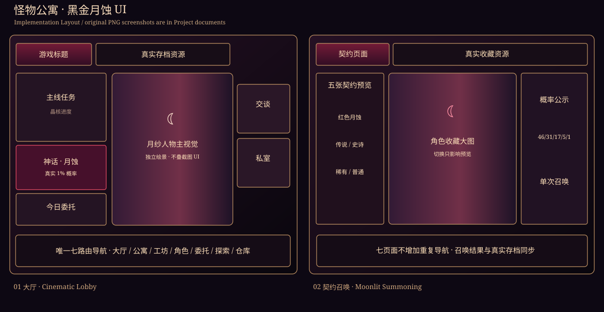

# 2026-10-29 · 怪物公寓 UI 重制设计基线

## 原始设计图（原画保持独立）

请在 ChatGPT 持久项目文档库查看以下三张原始 PNG：

`游戏调研 / 怪物公寓 / 项目文档 / UI重制 / 2026-10-29-哥特黑金参考 /`

- `01-大厅主界面设计图.png` — 全屏月夜人物场景、左侧主线/神话月蚀/消息、右侧月纱互动、黑金底部导航。
- `02-契约召唤界面设计图.png` — 卡池预览、红色月蚀、中央角色大图、右侧概率与收录、单抽入口。
- `03-月蚀人物CG候选.png` — 未审批美术候选，仅作人物氛围参考。

以上原始图片不作为游戏已审核的生产图片。原始设计清单的三个指定文件尚未逐一确认入库。R12.102 候选将此前公开目录三张历史参考 PNG 按原 Git blob 移入本目录 `references/`，保留旧文件名；这不证明三张与外部原始清单一一相同。

## 设计 Token

| 层 | 原则 |
|---|---|
| 主色 | 黑紫 `#100b13`、酒红 `#6b102c`、月蚀 `#aa2147`、象牙 `#fae5c8` |
| 边框 | 哑光金 `#c79b68`，双线描边，尽量薄而非叠厚重卡片 |
| 场景 | 背景照片/绘景占满屏幕，不缩放动画图像本体；人物保持高画质 |
| 布局 | 大厅左主线、中人物、右互动、底部固定 7 个唯一全局目的地 |
| 交互 | 所有资源读真实存档；活动若无真实时限不能出现假倒计时或“限定概率提升” |
| 移动端 | 缩小面板并允许内部滚动；保持七个路由可点击，避免叠加另一套菜单 |
| 减少动画 | 支持系统偏好及游戏内已有减少动态特效开关 |

## 本轮实际实施

- 大厅保留原有存档经营、与月纱交谈、特别委托、委托提醒；将 UI 迁入参考图的布局节奏。
- 黑金底部导航只在大厅使用电影感宽版；其他六页现有 dock 保留，避免一次性影响全部功能。
- 月蚀主题从大厅直达角色页面已有 `#summon` 区域，不增加第八路由，也不虚构限时日期。
- 契约召唤保留真实 46/31/17/5/1 概率、真实碎片装备数据、房间与工坊存档。
- 自动化测试必须覆盖 1440×900、390×844 以及移动端的可点击与无水平溢出。

## 后续美术边界

屏幕上的设计图是构图规范，不允许直接当成已完成的透明角色 Sprite 或重新叠加含 UI 文字的截图背景。需要独立生产实景、人物、卡面和装饰图层并分别过审。

## 可校验的原图清单

`references-manifest.json` 包含原始 PNG 的 SHA-256、精确像素和文件大小。原图可从本对话交付的设计资源 ZIP 或持久项目文档库取回，放入 `references/` 后校验。项目文档中的 SVG 是布局示意，不是原设计图的复制品。

## 2026-10-30 · 美女与野兽产品和素材联合计划

新设计已转入 [《美女与野兽》产品—素材路线图](../2026-10-30-beauty-beasts/ROADMAP.md) 与 [人物/异兽视觉圣经](../2026-10-30-beauty-beasts/CHARACTER_AND_BEAST_BIBLE.md)。新计划明确哪些环节应继续工程打磨、哪些环节必须生成**独立无字高清角色和野兽图片**，并说明审批、素材入库、代码引用、CI、Pages 全链路验收。现有 2026-10-29 PNG 设计参考与 2026-10-30 三张概念图都不能被标记为已接入游戏。

## R12.102 · 仓库现有参考图隔离（候选）

- [Gothic_Moonlit_Summoning_Screen_8181b3a5.png](references/Gothic_Moonlit_Summoning_Screen_8181b3a5.png)：2726560 B，Git blob `3be0ecd75dd6b4ab30c674e21f2a1aaa59d96c16`。
- [image_26a43a92.png](references/image_26a43a92.png)：3154947 B，Git blob `6c8131dd6719de4cbc5421e9d494900eafdae7c0`。
- [image_6273408e.png](references/image_6273408e.png)：3279821 B，Git blob `ea8234301ea325a4af5b4ede7ac0d13a711931aa`。

三图仅供历史设计参考；未确认外部原图 SHA-256 对应关系、不授予生产审批，不允许由运行时加载。原始外部文件清单保持原值；实际仓库副本见 manifest 的 repositoryReferenceCopies。
